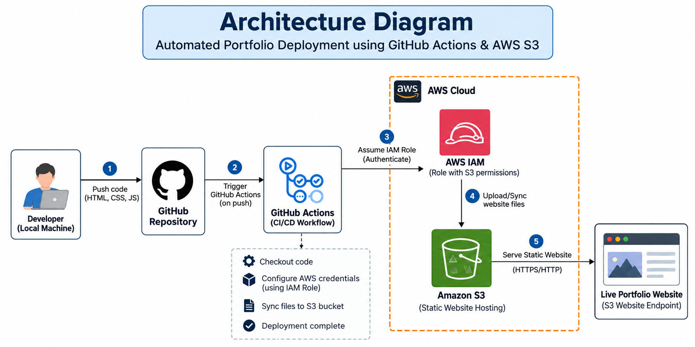
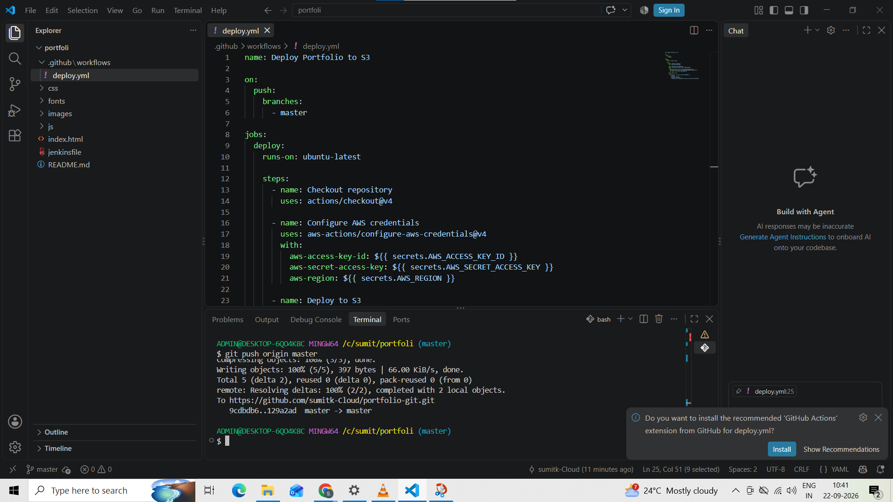
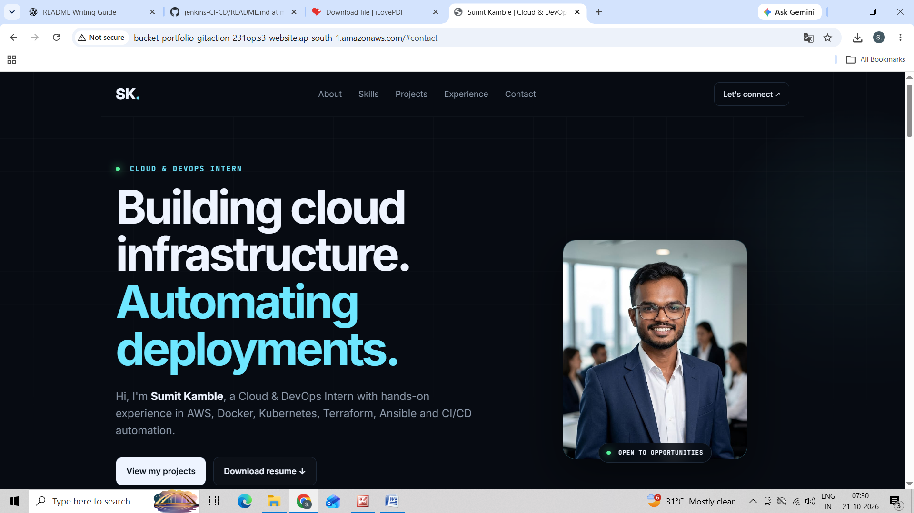

# 🚀 Automated Portfolio Deployment using GitHub Actions & AWS S3

## 📌 Project Overview

This project demonstrates the automated deployment of a static portfolio website to **Amazon S3** using GitHub Actions CI/CD. Whenever changes are pushed to the GitHub repository, the pipeline automatically deploys the updated website to the S3 bucket.

AWS IAM is used to provide the required permissions for secure deployment.

## 🎯 Project Objectives

- Automate website deployment using GitHub Actions.
- Host a static portfolio website on Amazon S3.
- Implement CI/CD for continuous updates.
- Use AWS IAM roles for controlled access to AWS resources.
- Reduce manual deployment effort.

## 🛠️ Technologies Used

- **AWS S3** – Static website hosting and file storage.
- **GitHub Actions** – CI/CD pipeline automation.
- **AWS IAM** – Access management and deployment permissions.
- **Git & GitHub** – Version control and source code management.
- **HTML, CSS, JavaScript** – Portfolio website development.

## 🏗️ Architecture

Developer → Git Push → GitHub Repository → GitHub Actions Workflow → AWS Authentication using IAM Role → Amazon S3 → Live Portfolio Website

### Architecture Diagram

## ⚙️ How It Works

1. Develop or update the portfolio website locally.
2. Push the changes to the GitHub repository.
3. GitHub Actions automatically triggers the workflow.
4. The workflow authenticates with AWS using the configured IAM role.
5. Website files are synchronized with the Amazon S3 bucket.
6. The updated portfolio becomes available through the configured website endpoint.

## 📸 Project Screenshots

### 1. Portfolio Website

**Live Website:** [View My Portfolio](http://bucket-portfolio-gitaction-231op.s3-website.ap-south-1.amazonaws.com/#contact)

### 2. GitHub Actions CI/CD Pipeline

### 3. Amazon S3 Bucket

### 4. GitHub Repository Secrets

### 5. IAM Roles Attached

### 6. Successful Deployment

## 🔐 Security Implementation

- Used AWS IAM to control deployment permissions.
- Configured AWS authentication for the GitHub Actions workflow.
- Followed the principle of least privilege wherever applicable.
- Avoided storing AWS access keys directly in the source code.

## 💡 Key Learnings

- Configuring GitHub Actions workflows.
- Implementing CI/CD for static websites.
- Hosting websites on Amazon S3.
- Configuring IAM permissions for automated deployment.
- Managing website updates through Git version control.

## 🚀 Future Improvements

- Configure Amazon CloudFront for content delivery.
- Add a custom domain and HTTPS.
- Implement automated validation before deployment.
- Add a production deployment approval process.

## 👨‍💻 Author

**Sumit Kamble**

- **GitHub:** [sumitk-Cloud](https://github.com/sumitk-Cloud/)
- **LinkedIn:** [Sumit Kamble](https://linkedin.com/in/sumit-kamble-a6a3b5405)
- **Email:** [sumitkamble5550@gmail.com](mailto:sumitkamble5550@gmail.com)

---

⭐ If you find this project useful, consider giving the repository a star.
